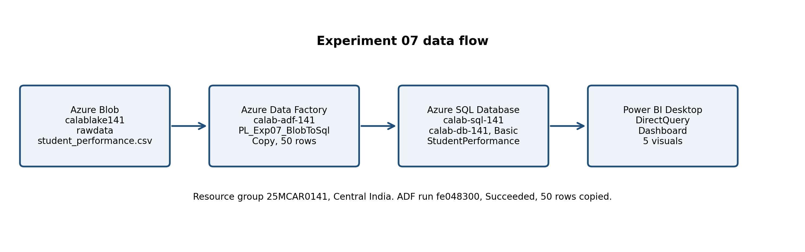

# Experiment 07: Connect Power BI to Azure SQL and Create a Dashboard with Real-Time Insights

> **Course Outcome**: CO4
> **Course**: Cloud Analytics (25MCASC302L)
> **Target Document**: CA_Exp07_PowerBI_AzureSQL.pdf

## Aim

To connect Power BI to an Azure SQL Database and create a dashboard that shows student performance insights, with data refreshed from the database rather than from a static file.

## Architecture

Azure Blob Storage (calablake141, rawdata, student_performance.csv) is copied by Azure Data Factory (calab-adf-141, pipeline PL_Exp07_BlobToSql) into Azure SQL Database (calab-sql-141, calab-db-141, table StudentPerformance). Power BI Service connects to that database through a semantic model refresh, so a change in the database is visible after the semantic model is refreshed.

## Resources

| Component | Resource name | Role |
| --- | --- | --- |
| Resource Group | 25MCAR0141 | Logical container for all experiment resources |
| Storage Account | calablake141 | Azure Data Lake Storage Gen2, rawdata container |
| Data Factory | calab-adf-141 | Pipeline PL_Exp07_BlobToSql, Copy activity |
| SQL Server | calab-sql-141.database.windows.net | Azure SQL Server, Central India, version 12.0 |
| SQL Database | calab-db-141 | Basic, 5 DTU, table StudentPerformance |
| Power BI | Power BI Service, Import | Report Exp07_PowerBI_AzureSQL, 5 visuals, semantic model refresh |

## Verified execution, 2026-11-01

- Azure SQL Server calab-sql-141: Ready, Central India.
- Azure SQL Database calab-db-141: Online, Basic, 5 DTU.
- ADF pipeline PL_Exp07_BlobToSql, run fe048300-50fb-4bd9-8236-afc838135573: Succeeded.
- ADF Copy activity CopyBlobToSql: rowsRead 50, rowsCopied 50, dataRead 3,174 bytes, dataWritten 4,754 bytes, copy duration 12 seconds, 4 Data Integration Units.
- Source file: student_performance.csv, 50 data rows, 13 columns, from calablake141 rawdata.
- A first ADF run failed with Invalid object name StudentPerformance, because the table did not exist. The pipeline was corrected with a preCopyScript that creates the table if it does not exist, and the second run succeeded. This failure and fix are part of the record, not hidden.

## Dashboard data, from the 50 rows in calab-db-141

Overall averages: MathScore 67.32, ReadingScore 67.38, WritingScore 66.36, AttendanceRate 80.79 (45 non-null values), StudyHoursPerWeek 11.40 (45 non-null values). Grade counts: A 16, B 12, C 10, D 6, F 6. Gender: Male 25, Female 25.

Average scores by FinalGrade:

| FinalGrade | Students | Avg MathScore | Avg ReadingScore | Avg WritingScore |
| --- | --- | --- | --- | --- |
| A | 16 | 87.50 | 90.38 | 88.62 |
| B | 12 | 73.17 | 76.58 | 74.83 |
| C | 10 | 57.60 | 53.80 | 53.10 |
| D | 6 | 46.67 | 43.67 | 42.17 |
| F | 6 | 38.67 | 34.00 | 36.33 |

## Power BI dashboard visuals

1. KPI cards: total students 50, average MathScore 67.32, average ReadingScore 67.38, average WritingScore 66.36.
2. Clustered column chart: average MathScore, ReadingScore, and WritingScore by FinalGrade.
3. Bar chart: student count by FinalGrade.
4. Donut chart: student share by Gender, 25 Male and 25 Female.
5. Table: FinalGrade, student count, and the three average scores, sorted by FinalGrade.

Power BI connection, in Power BI Service: Azure SQL Database, server calab-sql-141.database.windows.net, database calab-db-141, Microsoft account authentication, table StudentPerformance, Import mode. Refresh the semantic model after any database change to show the updated insight.

## Power BI report, verified

Saved report: Exp07_PowerBI_AzureSQL
URL: https://app.powerbi.com/groups/cfa9da9e-3370-4b81-b46c-b14de945b284/reports/465564ae-997f-4257-8264-fb4c77037e35/d2678006950ecc77ae81?experience=power-bi
Semantic model: Exp07_PowerBI_AzureSQL, last refresh succeeded 2026-11-01 at 7:50 PM.
Connection mode: Import. No DirectQuery choice was offered in the Power BI Service quickcreate flow used, verified in the semantic model settings.
Visuals on Page 1, verified in the editor:
1. KPI cards: Count of StudentID 50; Average of MathScore 67.32; Average of ReadingScore 67.38; Average of WritingScore 66.36.
2. Clustered column chart: average MathScore, ReadingScore, WritingScore by FinalGrade.
3. Clustered bar chart: Count of StudentID by FinalGrade, A 16, B 12, C 10, D 6, F 6.
4. Donut chart: Count of StudentID by Gender, Female 25 (50%), Male 25 (50%).
5. Table: FinalGrade, Count of StudentID, Average of MathScore, Average of ReadingScore, Average of WritingScore, total 50, 67.32, 67.38, 66.36.

Power BI connection, in Power BI Service: Get data from Azure SQL Database, server calab-sql-141.database.windows.net, database calab-db-141, Microsoft account authentication, table StudentPerformance. No SQL password was used for the Power BI connection.

## Screenshots, Section 6 of the PDF

Screenshots are stored in the screenshots/ subfolder of Lab/Exp_07, not in the Exp_07 root.

Real browser screenshots of the saved Power BI Service report, captured 2026-11-01, not replotted charts:

- screenshots/screenshot_powerbi_report_all.jpg: Page 1 at 50 percent, all 5 visual groups in one view.
- screenshots/screenshot_powerbi_report_top.jpg: Page 1 at 100 percent, top, KPI cards, column chart, bar chart.
- screenshots/screenshot_powerbi_report_bottom.jpg: Page 1 at 100 percent, lower part, donut chart by Gender and FinalGrade table.
- screenshots/screenshot_powerbi_semantic_model.jpg: semantic model settings, last refresh succeeded 11/1/2026, 7:50:00 PM.
- screenshots/screenshot_powerbi_semantic_model_refresh.jpg: cloud connection calab-sql-141.database.windows.net, database calab-db-141, and Refresh section, Import mode evidence.

## Files

Image files are stored in the images/ subfolder of Lab/Exp_07, not in the Exp_07 root.

Code files are stored in the code/ subfolder of Lab/Exp_07, not in the Exp_07 root.

- images/architecture_diagram.png: data flow diagram.
- images/dashboard_avg_by_grade.png: average scores by FinalGrade, from the real 50 rows, earlier plotted chart, not used in the PDF Screenshots section.
- images/dashboard_grade_counts.png: student count by FinalGrade, from the real 50 rows, earlier plotted chart, not used in the PDF Screenshots section.
- code/create_table.sql: table definition used by the ADF preCopyScript.
- code/dashboard_queries.sql: queries for the dashboard tables and averages.
- code/pipeline_PL_Exp07_BlobToSql.json: ADF pipeline definition, without connection secrets.

## Cost guard

Azure SQL Database is Basic, 5 DTU, the smallest paid tier used for this lab. Keep the database only until the Power BI Desktop run and submission are complete, then delete the database and, if no other experiment needs it, the server, to stop the hourly charge. Do not leave the database running for the rest of the week without a reason.
